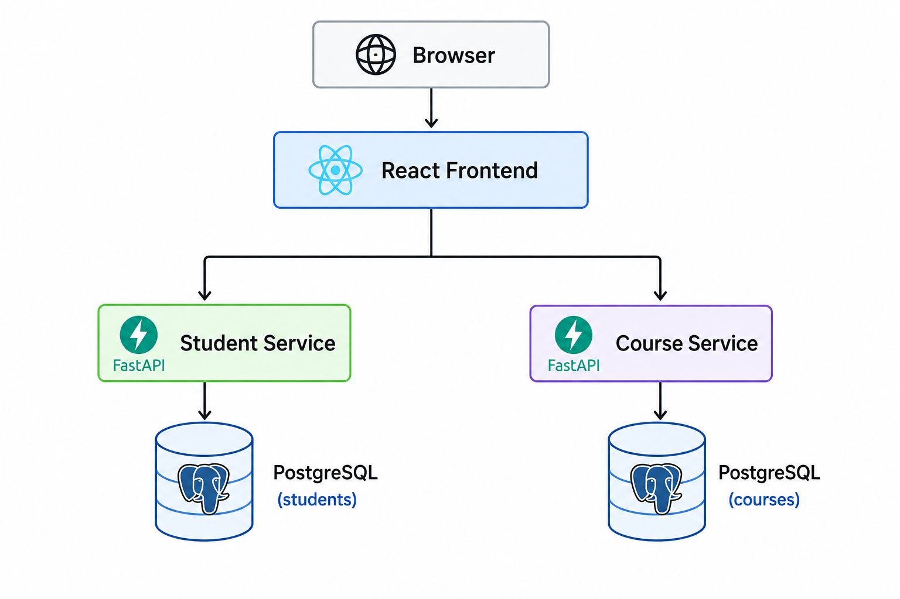

# Week 03 - Multi-Service Application with Docker Compose

## Overview

In Week 03, you will extend the **University Course Registration System** by introducing a **microservices architecture** and deploying multiple services using **Docker Compose**.

Unlike Week 02, which contained a single FastAPI application, this week's solution consists of:

* Student Service (FastAPI)
* Course Service (FastAPI)
* Student Database (PostgreSQL)
* Course Database (PostgreSQL)
* Frontend (React)

Docker Compose will be used to **build**, **configure**, **network**, and run all services using a single command.

---

## Learning Outcomes

After completing this practical, you should be able to:

* Understand a basic microservices architecture.
* Build and deploy multiple containers using Docker Compose.
* Connect multiple FastAPI services with PostgreSQL databases.
* Configure communication between containers.
* Execute unit tests for backend and frontend applications.
* Verify communication between frontend and backend services.

---

## Application Architecture


---

# Setup Instructions

1. Clone the Repository

    ```bash
    git clone https://github.com/sit722-devops/week03.git
    ```

2. Navigate to the Project

    ```bash
    cd week03
    ```

3. Open the Project

       Open the `week03` folder using Visual Studio Code.
---

## Backend Setup

The Student Service and Course Service each have their own Python environment and dependencies.

### Student Service

1. Navigate to the Student Service.

    ```bash
    cd student-service
    ```

2. Create a virtual environment.

    ```bash
    # Create the virtual environment
    python -m venv .venv

    # Activate the virtual environment
    # On macOS/Linux:
    source ./.venv/bin/activate

    # On Windows (Command Prompt):
    # .\.venv\Scripts\activate.bat

    # On Windows (PowerShell):
    # .\.venv\Scripts\Activate.ps1
    ```

3. Install dependencies.

    ```bash
    pip install -r requirements.txt
    ```

4. Return to the project root.

    ```bash
    cd ..
    ```

---

### Course Service

1. Navigate to the Course Service.

    ```bash
    cd course-service
    ```

2. Create a virtual environment.

    ```bash
    # Create the virtual environment
    python -m venv .venv

    # Activate the virtual environment
    # On macOS/Linux:
    source ./.venv/bin/activate

    # On Windows (Command Prompt):
    # .\.venv\Scripts\activate.bat

    # On Windows (PowerShell):
    # .\.venv\Scripts\Activate.ps1
    ```

3. Install dependencies.

    ```bash
    pip install -r requirements.txt
    ```

4. Return to the project root.

    ```bash
    cd ..
    ```

---

## Frontend Setup

1. Navigate to the frontend.

    ```bash
    cd frontend
    ```

2. Install the required Node.js packages.

    ```bash
    npm install
    ```

3. Return to the project root.

    ```bash
    cd ..
    ```

---

## Execute Unit Tests

Before deploying the application using Docker Compose, ensure all unit tests pass successfully.

### Student Service

```bash
cd student-service
pytest tests
cd ..
```

> **NOTE**:
> The Student Service unit tests require a PostgreSQL database named students.
> If the database does not already exist, create it before running the tests.
> CREATE DATABASE students;
> The test suite will automatically create the required database tables if they do not already exist.

### Course Service

```bash
cd course-service
pytest tests
cd ..
```

> **NOTE**:
> The Course Service unit tests require a PostgreSQL database named courses.
> If the database does not already exist, create it before running the tests.
> CREATE DATABASE courses;
> The test suite will automatically create the required database tables if they do not already exist.

### Frontend

```bash
cd frontend
npm test
cd ..
```

---

## Run the Application Using Docker Compose

From the project root directory, execute:

```bash
docker compose build --no-cache

docker compose up -d
```

> **NOTE:** Depending on your version of Docker, you may need to replace `docker compose` with `docker-compose`, such as:
> ```bash
> docker-compose build --no-cache
> 
> docker-compose up -d
> ```


Docker Compose will automatically:

* Build the Student Service image.
* Build the Course Service image.
* Build the Frontend image.
* Create the Student PostgreSQL database container.
* Create the Course PostgreSQL database container.
* Create the Docker network.
* Connect all services together.

---

## Verify Running Containers

Run following:

```bash
docker compose ps
```

You should see the following containers running:

* frontend
* student-service
* course-service
* student-db
* course-db

---

## View Container Logs

View logs for all containers.

```bash
docker compose logs
```

View logs for the Student Service.

```bash
docker compose logs student-service
```

View logs for the Course Service.

```bash
docker compose logs course-service
```

View logs for the Frontend.

```bash
docker compose logs frontend
```

---

## Access the Application

### Frontend

```
http://localhost:5173
```

### Student Service Swagger UI

```
http://localhost:8001/docs
```

### Course Service Swagger UI

```
http://localhost:8002/docs
```

---

## Verify the Application

Using the frontend:

* Create a new student.
* Verify the student appears in the Students table.
* Create a new course.
* Verify the course appears in the Courses table.

Using Swagger UI:

### Student Service

* `GET /students`
* `GET /students/{student_id}`
* `POST /students`

### Course Service

* `GET /courses`
* `GET /courses/{course_id}`
* `POST /courses`

---

## Stop the Application

Stop all running containers.

```bash
docker compose down
```

To also remove the PostgreSQL volumes and start with a fresh database next time, run:

```bash
docker compose down -v
```